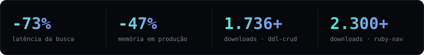

**Back-end com foco em performance, IA e sistemas de alta escala.**
Laravel · Ruby on Rails · FastAPI · Visão Computacional

[portfólio](https://alysontrizotto.vercel.app) · [linkedin](https://www.linkedin.com/in/alyson-trizotto/) · [e-mail](mailto:alysontrizotto1@gmail.com)

---

## `// cases`

| Case | Resultado |
| --- | --- |
| [Motor de Busca Crítico](https://github.com/AlysonTrizotto/impact-cases/tree/main/cases/motor-busca-otimizacao-2026) | −73% de latência em produção (10,63s → 2,87s), RAM −47% |
| [laravel-ddl-crud](https://github.com/AlysonTrizotto/laravel-ddl-crud) | Pacote Composer: CRUD completo a partir de DDL SQL |
| [YOLO OCR de Placas](https://github.com/AlysonTrizotto/impact-cases/tree/main/cases/yolo-ocr-placas-veiculares) | YOLOv11 + TensorRT em produção na Ofisys |
| [Benchmark de Frameworks](https://github.com/AlysonTrizotto/benchmark) | 6 stacks comparadas em I/O real |
| [Inspeção Veicular Universal](https://github.com/AlysonTrizotto/impact-cases/tree/main/cases/tese-inspecao-veicular-universal-2026) | Tese de mestrado: YOLOv11 + SAHI + ByteTrack |
| [Staff+ Skills](https://github.com/AlysonTrizotto/skills) | 16 skills de governança para agentes de IA |

Todos em [impact-cases](https://github.com/AlysonTrizotto/impact-cases), com código, métricas e lições aprendidas.

## `// stack`

`PHP` `Laravel` `Hyperf` `Ruby on Rails` `Python` `FastAPI` `Node` · `PostgreSQL` `Redis` `Kafka` · `Docker` `Datadog` `TensorRT` · `YOLOv11` `PyTorch`

## `// código em números`

  
  

Atualizado automaticamente a cada 6h por GitHub Actions. Linguagens em bytes (API do GitHub), repos próprios, sem forks.
